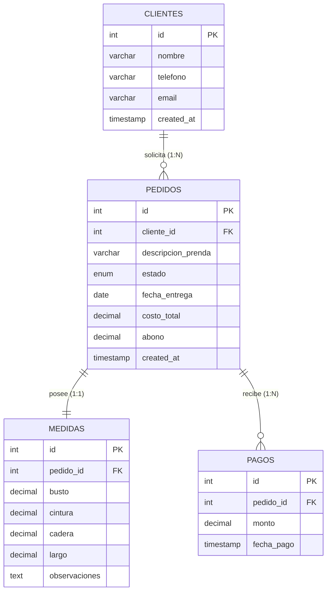

# Sistema de Gestión Monolítico para Taller de Costuras

Aplicación web monolítica desarrollada con **PHP 8 (PDO)** y **MySQL 8 (InnoDB)**, concebida bajo principios de ingeniería backend senior: **integridad referencial estricta, operaciones ACID mediante transacciones atómicas, prevención de inyecciones SQL nativas y una arquitectura limpia y mantenible**.

---

## 1. Arquitectura y Estructura del Proyecto

El proyecto sigue una estructura limpia que desacopla la configuración, la persistencia de datos, los componentes de interfaz reutilizables y los controladores/vistas de negocio:

```text
c:\laragon\www\costuras\
├── config/                  # (Opcional) Archivos de configuración adicional
├── database/
│   └── schema.sql           # Definición DDL, restricciones foráneas y datos semilla
├── includes/
│   ├── header.php           # Encabezado HTML5, estilos Bootstrap 5 y barra de navegación
│   ├── footer.php           # Cierre de contenedor, pie de página y scripts Bootstrap
│   └── helpers.php          # Funciones auxiliares (prevención XSS, formateo de moneda/fechas, alertas flash)
├── conexion.php             # Conexión centralizada PDO con manejo de excepciones y configuración segura
├── schema.sql               # Script SQL en la raíz para importación rápida
├── index.php                # Panel de control: listado de pedidos, filtros y balances financieros
├── crear_pedido.php         # Transacción atómica: alta de cliente, orden, medidas y abono inicial
├── ver_pedido.php           # Consulta detallada: cliente, especificaciones, medidas y bitácora de pagos
├── actualizar_estado.php    # Transacción segura con bloqueo pesimista: cambio de estado y registro de abonos
├── eliminar_pedido.php      # Eliminación atómica transaccional de pedidos y registros dependientes
└── README.md                # Documentación técnica completa
```

---

## 2. Modelo Relacional de Base de Datos

La base de datos utiliza el motor **InnoDB** con codificación **`utf8mb4`** y cotejamiento **`utf8mb4_unicode_ci`**.



### Justificación de Restricciones y Llaves Foráneas:
1. **`fk_pedidos_cliente` (`ON DELETE RESTRICT ON UPDATE CASCADE`)**:  
   Impide eliminar un cliente de la base de datos si existen pedidos históricos asociados, resguardando la integridad fiscal y contable.
2. **`fk_medidas_pedido` (`ON DELETE CASCADE ON UPDATE CASCADE`)**:  
   Garantiza que la ficha de medidas no exista huérfana si un pedido es retirado del sistema.
3. **`fk_pagos_pedido` (`ON DELETE RESTRICT ON UPDATE CASCADE`)**:  
   Protege la bitácora contable impidiendo eliminaciones directas de pedidos con pagos sin un procedimiento transaccional supervisado.

---

## 3. Lógica Transaccional e Integridad de Datos

Todas las operaciones críticas se ejecutan dentro de bloques de transacción controlados con **PDO**:

### A. Creación de Pedido (`crear_pedido.php`)
Cuando se registra un encargo, el sistema realiza hasta 4 operaciones en una única unidad de trabajo indivisible:
1. **Cliente:** Reutiliza un cliente existente validado o inserta uno nuevo en la tabla `clientes`.
2. **Pedido:** Inserta la orden en `pedidos` con el `cliente_id` obtenido.
3. **Medidas:** Inserta las medidas corporales en la tabla `medidas` usando el `pedido_id` generado (`$pdo->lastInsertId()`).
4. **Pago Inicial:** Si el cliente dejó un abono inicial (`abono > 0`), se crea el asiento contable correspondiente en la tabla `pagos`.

> Si alguna de estas sentencias falla (por error de red, fallo de restricción o dato inválido), el bloque `catch (Throwable $e)` invoca `$pdo->rollBack()`, cancelando todo y evitando registros huérfanos.

### B. Registro de Pagos Parciales y Cambio de Estado (`actualizar_estado.php`)
Para prevenir **condiciones de carrera** (Race Conditions) si dos operadores intentan registrar un pago simultáneamente:
1. Se inicia la transacción `$pdo->beginTransaction()`.
2. Se realiza un bloqueo pesimista de fila mediante `SELECT ... FOR UPDATE`:
   ```sql
   SELECT id, costo_total, abono, estado FROM pedidos WHERE id = :id FOR UPDATE;
   ```
3. Se valida que el nuevo monto no exceda el saldo pendiente real (`costo_total - abono`).
4. Se registra el nuevo pago en la tabla `pagos`.
5. Se actualiza el campo acumulado `abono` en la tabla `pedidos`.
6. Si cambió el estado (`Pendiente`, `En Proceso`, `Prueba Lista`, `Entregado`, `Cancelado`), se actualiza en el mismo `commit()`.

---

## 4. Medidas de Seguridad Implementadas

- **Prevención de SQL Injection**:  
  Uso de Sentencias Preparadas nativas (`PDO::ATTR_EMULATE_PREPARES => false`). Ningún parámetro proveniente de `$_GET` o `$_POST` se concatena directamente en las consultas SQL.
- **Prevención de Cross-Site Scripting (XSS)**:  
  Todas las cadenas impresas en las vistas HTML pasan por la función auxiliar `e()`, que ejecuta `htmlspecialchars($cadena, ENT_QUOTES, 'UTF-8')`.
- **Validación Estricta de Tipos y Rangos**:  
  Validaciones de formato decimal, validación de fechas con `strtotime` y comprobación de listas blancas (whitelisting) para los valores del tipo `ENUM`.
- **Protección contra CSRF y Peticiones Accidentales**:  
  Las operaciones destructivas (como `eliminar_pedido.php`) y de escritura exigen estrictamente el método `POST`.

---

## 5. Instrucciones de Instalación y Puesta en Marcha

### Prerrequisitos
- Servidor local: **Laragon** (recomendado) o **XAMPP** con PHP 8.0+ y MySQL 8.0+ / MariaDB 10.4+.

### Pasos de Despliegue:

1. **Ubicación de los archivos**:
   Coloca el proyecto en el directorio raíz de Laragon:
   ```text
   C:\laragon\www\costuras\
   ```

2. **Crear la Base de Datos e Importar el Esquema**:
   - Abre Laragon y pulsa **"Iniciar todo"** (Apache y MySQL).
   - Abre **HeidiSQL** (o phpMyAdmin en `http://localhost/phpmyadmin`).
   - Abre el archivo [schema.sql](file:///c:/laragon/www/costuras/schema.sql) y ejecútalo.
   - El script creará automáticamente la base de datos `taller_costuras`, las 4 tablas con sus relaciones y datos de prueba.

   *Alternativa por consola MySQL:*
   ```bash
   mysql -u root -p < c:\laragon\www\costuras\schema.sql
   ```

3. **Verificar Configuración de Conexión**:
   Revisa el archivo [conexion.php](file:///c:/laragon/www/costuras/conexion.php). Los valores predeterminados son compatibles con Laragon y XAMPP:
   - Host: `localhost`
   - Puerto: `3306`
   - Base de Datos: `taller_costuras`
   - Usuario: `root`
   - Contraseña: `""` (vacía)

4. **Acceder a la Aplicación**:
   Abre tu navegador web en cualquiera de las siguientes URLs:
   - **Con Laragon (Virtual Host automático):** `http://costuras.test`
   - **Vía Localhost estándar:** `http://localhost/costuras/index.php`

---

## 6. Verificación y Casos de Prueba Recomendados

1. **Prueba de Creación con Nuevo Cliente y Abono**:
   - Ingresa a `crear_pedido.php`.
   - Selecciona "Registrar Nuevo Cliente", completa los datos, define un costo de `$150.000` y un abono inicial de `$50.000`.
   - Presiona "Guardar Pedido".
   - **Resultado esperado**: Se crean simultáneamente el cliente, el pedido con saldo pendiente de `$100.000`, la ficha de medidas y el primer registro en la tabla de pagos.

2. **Prueba de Pago Parcial y Control de Saldo**:
   - Accede a `actualizar_estado.php` sobre el pedido anterior.
   - Intenta ingresar un monto de `$200.000` (superior al saldo de `$100.000`).
   - **Resultado esperado**: La transacción se revierte con un mensaje de validación impidiendo cobros excesivos.
   - Ahora ingresa un monto válido de `$50.000`.
   - **Resultado esperado**: El saldo se actualiza a `$50.000` y se agrega la fila a la bitácora de pagos.

3. **Prueba de Consulta y Filtros**:
   - En `index.php`, utiliza la barra de filtros para segmentar por estados ("Activos", "Pendiente", "En Proceso", "Entregado").

